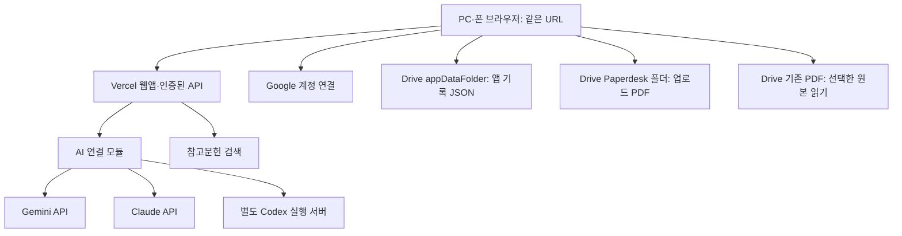

# 논문 리딩 & 멀티 AI 질문 웹앱 기획서

- 최초 작성일: 2026-11-19
- 수정일: 2026-11-20
- 버전: 0.3 — 사용자의 Google Drive를 기본 저장소로 확정, Supabase 의존 제거
- 상태: Google Drive 기반 앱 구현과 GitHub·Vercel 배포를 완료했다. 운영 앱과 독립된 localhost origin에서 실제 Google 계정의 PDF·스크랩·메모·읽기 위치 복원을 확인했다. Picker 파일 선택·중복 감지와 DOI 참고문헌 검색도 확인했다. 설정한 Gemini 세 모델은 프로젝트 월 지출 한도(HTTP 429)로 정상 답변 수신이 막혀 있다. 실제 PC·폰 사용과 각 AI의 정상 답변 등 남은 수용 기준은 확인 전까지 완료로 간주하지 않는다.

## 1. 제품 목표와 확정 요구사항

**하나의 URL에서 논문을 읽고, 문장을 스크랩해 원하는 AI에 질문하며, 참고문헌까지 별도 대화로 탐색하는 개인용 웹앱. PC와 폰에서 같은 계정으로 이어서 사용한다.**

PC에서는 왼쪽에 논문, 오른쪽에 질문·답변을 표시한다. 폰에서는 논문과 질문 화면을 편하게 전환한다. 논문은 내 기기의 폴더나 Google Drive에서 선택하고, 읽던 위치·스크랩·대화를 기기 간에 동기화한다.

| 사용자 요구 | 이번 기획의 반영 내용 |
| --- | --- |
| Codex 외 Gemini·Claude 등 선택 | 서비스와 모델을 선택하는 공통 대화창, 서비스별 연결 모듈 |
| 내 폴더에서 논문 열기 | PC·폰의 파일 선택기로 PDF 열기, PC 드래그앤드롭 |
| Google Drive에서 바로 열기 | 앱 안의 Drive 파일 선택창으로 PDF를 골라 열기 |
| 별도 DB 대신 Google Drive 사용 | 일반 `Paperdesk` 폴더에 업로드 PDF, 앱 전용 `appDataFolder`에 기록 저장 |
| 참고문헌을 찾고 사이드 채팅 | 인용 표시·참고문헌 목록에서 검색하고 문헌별 대화 열기 |
| Git에 푸시하고 Vercel로 배포 | GitHub 저장소를 기본 후보로 삼아 Vercel 자동 배포 연결 |
| URL로 PC·폰 번갈아 사용 | 반응형 웹, 같은 Google 계정 연결, Drive 동기화와 읽기 위치 복원 |

설치형 Windows 앱 중심의 이전 설계를 웹앱 중심으로 변경한다. 개인 PC가 꺼져 있어도 서버에서 AI 요청을 처리할 수 있어야 한다. 기기 동기화와 Drive 연결은 첫 배포 범위에 포함한다.

## 2. 대표 사용 흐름

### 2.1 논문을 읽으며 질문하기

1. PC에서 앱 URL에 접속해 사용할 Google 계정을 연결한다.
2. `내 기기에서 열기` 또는 `Google Drive에서 열기`로 PDF를 선택한다.
3. 논문을 읽다가 문장·문단을 선택하고 `질문하기` 또는 `스크랩`을 누른다.
4. 질문창에 인용문과 출처 페이지가 붙는다.
5. `Codex / Gemini / Claude` 중 연결된 서비스를 선택하고 사용할 모델을 고른다.
6. 질문을 작성하거나 `쉽게 설명`, `한국어 번역`, `배경 개념`으로 질문 초안을 만든다.
7. 전송하면 답변이 생성되는 순서대로 표시되고, 질문·답변·사용한 출처가 저장된다.
8. 저장 완료를 확인한 뒤 폰에서 같은 URL·Google 계정으로 연결해 읽던 위치와 대화를 이어서 본다.

현재 구현은 페이지를 새로고침하거나 탭을 다시 열면 로컬 서재로 시작한다. `연결 설정 → Google Drive로 연결`에서 저장했던 같은 Google 계정을 선택하고 `Google Drive 동기화 완료`를 기다린다. 계정 서재가 바로 보이지 않는 것은 기록 삭제를 뜻하지 않는다. 이미 연결한 상태에서 토큰이 만료되면 `Google 다시 연결`을 사용한다.

### 2.2 참고문헌을 따라가며 질문하기

1. 본문의 `[12]`, `(Kim et al., 2024)` 같은 인용 표시나 참고문헌 목록에서 관심 문헌을 선택한다.
2. 앱이 해당 참고문헌의 제목·저자·연도·DOI를 추출하고 검색한다.
3. 일치하는 문헌을 확인하면 오른쪽에 그 문헌의 대화를 연다.
4. `이 논문은 어떤 연구야?`, `지금 읽는 논문에서 왜 인용했을까?` 등을 질문한다.
5. 확보된 자료가 서지정보인지, 초록인지, 원문인지 대화 상단에 표시한다.
6. 필요하면 공개 원문을 연결하거나 내 폴더·Drive에서 해당 PDF를 추가한다.
7. 원 논문의 읽던 위치를 유지한 채 본문 대화와 참고문헌 대화를 오간다.

## 3. PC와 모바일 화면

사용자 요청에 따라 Apple Music 스타일을 화면의 시각적 방향으로 참고한다. 이 디자인 방향과 실제 기능·동기화 검증 상태는 구분한다.

### PC: 논문과 사이드 채팅

```text
┌──────────────────────────────────────────────────────────────────┐
│ 내 서재  내 기기에서 열기  Drive에서 열기  |  동기화 상태 · 계정  │
├──────────────────────────────────┬───────────────────────────────┤
│ 논문 제목 · 페이지 · 검색 · 확대 │ [질문] [스크랩] [참고문헌]    │
│                                  │                               │
│             PDF                  │ 대화: [본문 ▾] [참고문헌 #12]│
│                                  │ AI: [Gemini ▾] 모델: [선택 ▾]│
│ 문장 선택                        │                               │
│ [질문하기] [스크랩]              │ 인용문 · PDF 4페이지          │
│                                  │ 질문 / 답변                   │
│ 인용 [12] → 참고문헌 찾기        │                               │
│                                  │ 질문 입력…             [전송]│
└──────────────────────────────────┴───────────────────────────────┘
```

- 논문 약 65%, 오른쪽 패널 약 35%로 시작하며 너비를 조절한다.
- 본문 대화와 참고문헌별 대화는 오른쪽 패널 안에서 전환한다.
- 참고문헌 원문을 보더라도 `원 논문으로 돌아가기`로 이전 페이지·선택 위치를 복원한다.
- 질문 전송은 `Ctrl+Enter`, 줄바꿈은 `Enter`로 하며 한글 조합 중 전송을 방지한다.

### 모바일: 읽기와 질문을 전환

```text
┌────────────────────────┐
│ 논문 제목     동기화 ● │
├────────────────────────┤
│                        │
│   PDF 또는 선택한 대화 │
│                        │
│ 선택 문장 → 질문 / 저장│
├────────────────────────┤
│ 논문  질문  스크랩  참조│
└────────────────────────┘
```

- 작은 화면에서는 PDF와 채팅을 좁게 나란히 배치하지 않고 하단 탭으로 전환한다.
- 터치로 문장을 선택하면 질문·스크랩 동작을 제공하고, 탭을 옮겨도 선택한 인용문을 유지한다.
- 질문 화면의 `원문 보기`로 해당 페이지·강조 위치로 돌아간다.
- 참고문헌 채팅은 질문 화면의 대화 선택 메뉴에서 전환한다.
- PDF 확대·축소, 세로·가로 회전, 키보드가 열린 상태를 실제 모바일 브라우저에서 검증한다.
- PWA 홈 화면 추가는 편의 기능으로 검토한다. 일반 브라우저에서 URL만 열어도 핵심 기능을 사용할 수 있어야 한다.

## 4. 논문 가져오기와 파일 보관

### 4.1 내 폴더에서 열기

PC와 폰의 기본 파일 선택기로 PDF를 선택한다. PC에서는 드래그앤드롭도 지원한다. 초기 범위는 사용자가 선택한 파일이며, 폴더 전체를 지속 감시하는 기능은 후속 범위다.

**Google 연결 후 선택한 PDF를 본인 Drive의 비공개 `Paperdesk` 폴더에 업로드해 다른 기기에서도 연다.** 연결 전에는 별도의 로컬 서재에만 보관한다. 연결 전 자료가 계정 서재로 자동 이전되지는 않으므로, 기기 간에 사용할 PDF는 Google 연결 후 가져온다. 업로드 중에는 가능한 범위에서 로컬 미리보기를 제공한다. Drive API의 업로드 성공을 확인한 뒤에만 다른 기기에서 복원할 수 있는 상태로 취급한다. 첫 버전의 PDF 크기 제한은 파일당 50MB다.

폰에서 PC의 로컬 경로를 직접 여는 방식은 사용하지 않는다. 파일은 본인 Drive에 보관하고 Drive 파일 ID·내용 해시·버전으로 식별한다. `Paperdesk` 폴더를 공개하거나 다른 사람에게 공유할 필요가 없다.

### 4.2 Google Drive에서 바로 열기

1. `Google 연결`로 계정 확인과 앱에 필요한 Drive 접근 권한을 허용한다.
2. 앱 안에서 Google Picker를 열고 PDF를 선택한다.
3. 파일 ID와 메타데이터를 받아, 접근 가능한 PDF 내용을 읽기 화면에 표시한다.
4. 서재에는 Drive 파일 ID·버전·연결 계정과 읽기 기록을 저장한다.
5. 다른 기기에서도 같은 Google 계정과 유효한 Drive 연결로 해당 파일을 다시 연다.

Google Picker는 웹앱 내 파일 선택 UI를 제공한다. 앱은 선택·생성한 파일에 접근하는 `drive.file` 범위를 사용해 기존 PDF를 읽고 새 PDF를 업로드한다. 이 범위는 읽기 전용이 아니다. [Google Picker](https://developers.google.com/workspace/drive/picker/guides/overview), [Drive 권한 범위](https://developers.google.com/workspace/drive/api/guides/api-specific-auth)

PDF 같은 Drive 파일의 본문은 Drive API의 파일 다운로드 기능으로 가져올 수 있다. 다운로드 권한과 접근 가능 여부를 확인하며, Drive 미리보기 iframe만 띄워 스크랩 기능을 대신하지 않는다. [Drive 파일 다운로드](https://developers.google.com/workspace/drive/api/guides/manage-downloads)

- 같은 Google 연결에서 계정 확인용 `openid email profile`, 선택·생성 파일용 `drive.file`, 앱 기록용 `drive.appdata` 권한을 요청한다. 현재 Codex에 연결된 Drive 권한이 새 웹앱으로 자동 이전되지는 않는다.
- 이미 Drive에 있는 원본은 그 위치에 두고 파일 ID로 연결한다. 출처·스크랩·대화 및 필요한 추출 텍스트는 앱 전용 기록으로 저장한다.
- access token은 브라우저 메모리에만 보관한다. 페이지 새로고침·탭 재열기·토큰 만료 후에는 사용자가 같은 계정으로 다시 연결한다. 갱신 토큰의 지속 보관이나 무인 재인증을 전제하지 않는다.
- 원본 삭제·접근 권한 해제 후에도 기존 기기에 저장된 스크랩·대화는 보존하고 재연결을 제공한다. 연결 전에는 Drive에서 새 기록을 읽거나 쓰지 못한다.
- Drive 파일이 수정되면 새 버전으로 취급한다. 이전 좌표를 새 PDF에 그대로 적용하지 않고, 기존 스크랩에 원본 버전을 표시한다.
- 모바일에서 Picker와 인증 복귀가 정상 동작하는지 초기 검증에 포함한다.

### 4.3 앱 기록은 Drive의 앱 전용 공간에 저장

스크랩·대화·참고문헌 연결·읽기 위치는 `appDataFolder` 안에 JSON으로 저장한다. 이 공간은 일반 Drive 화면에 표시되지 않으며, 사용자에게 보이는 `Paperdesk` PDF 폴더와 다르다. 별도 Supabase 프로젝트나 데이터베이스는 사용하지 않는다. [Drive 앱 데이터](https://developers.google.com/workspace/drive/api/guides/appdata)

변경마다 고유 ID를 가진 작업 기록을 새 JSON으로 추가하고, 각 기기가 이를 읽어 병합한다. 여러 기기가 하나의 전체 상태 파일을 덮어쓰는 방식으로 구성하지 않는다. 미전송 변경과 PDF 캐시는 계정별 IndexedDB에 두고 Drive 저장이 확인될 때까지 보존한다.

**폴더 공유 링크만으로 앱 인증·읽기·쓰기를 연결할 수는 없다.** Google Cloud에서 Drive API·Picker API를 켜고 Web OAuth client, 제한된 Picker API key, 프로젝트 번호를 한 번 설정해야 한다. 폴더를 공유하지 않고 같은 Google 계정을 각 기기에서 연결한다. 설정 절차와 환경변수는 [앱 README](paperdesk/README.md)에 둔다.

## 5. AI 서비스·모델 선택

### 5.1 공통 동작

| 선택 항목 | 연결 방향 | 완료 기준 |
| --- | --- | --- |
| Codex | 서버 측 Codex 실행 환경과 공식 연결 방식 | PC가 꺼져 있어도 실제 Codex 답변·후속 질문 가능 |
| Gemini | Google의 공식 Gemini API | 선택한 Gemini 모델의 실제 답변 수신 |
| Claude | Anthropic의 공식 Claude API | 선택한 Claude 모델의 실제 답변 수신 |
| 추가 서비스 | 공통 연결 규격에 맞춘 모듈 확장 | 기존 PDF·스크랩 화면 수정 최소화 |

Gemini와 Claude는 각각 공식 API 연결 모듈을 구현한다. 모델 목록과 인증 방식은 구현 시 최신 공식 문서 및 계정의 사용 가능 범위로 확인한다. 특정 최신 모델명이나 무료 사용을 기획 단계에서 보장하지 않는다. [Gemini API 시작하기](https://aistudio.google.com/docs/get-started), [Claude Messages API](https://platform.claude.com/docs/en/api/messages)

- 질문창에서 서비스를 고른 뒤 해당 서비스에서 사용할 수 있는 모델을 선택한다.
- 연결되지 않은 서비스에는 설정 필요 상태를 표시한다. 실제 요청은 연결된 서비스에만 보낸다.
- 서비스 변경은 다음 요청부터 적용한다. 생성 중인 응답의 서비스·모델은 바꾸지 않는다.
- 기존 답변에는 당시 서비스·모델·출처·시각을 유지한다.
- 서비스를 바꿀 때 `현재 대화 이어가기` 또는 `첨부 자료로 새 대화`를 선택한다. 다른 제공자에게 전달될 이전 대화와 자료의 범위를 표시한다.
- 대화는 앱의 공통 형식으로 저장하고, 연결 모듈에서 서비스별 입력 형식으로 변환한다. 각 서비스의 내부 세션 ID만으로 대화를 보관하지 않는다.
- 긴 대화는 전달 범위를 줄이거나 요약한 뒤 그 상태를 표시한다. 문맥을 넘겨주지 못한 채 동일한 기억이 이어진다고 표현하지 않는다.
- 한 서비스가 실패해도 임의로 다른 제공자에게 자동 전송하지 않는다. 사용자가 재시도 또는 서비스 변경을 선택한다.

### 5.2 Codex 연결에서 별도로 검증할 점

Codex 자체와 OpenAI 모델 API 직접 호출은 구분한다. 일반 OpenAI API 답변을 `Codex`라고 표시하지 않는다. 향후 OpenAI API 직접 호출을 추가하면 별도 항목으로 표시한다.

Codex App Server는 자체 클라이언트를 위한 대화·이벤트 연결 기능을 제공한다. 이 기획에서는 별도 서버 실행 계층에서 Codex를 구동하는 방식을 후보로 둔다. [Codex App Server](https://learn.chatgpt.com/docs/app-server)

기존 개인용 Codex 로그인 정보를 Vercel 호스팅에 그대로 옮겨 사용하는 것은 확정안이 아니다. API 키 기반 실행, Sign in with ChatGPT 등 공식 경로에서 이 앱의 호스팅 형태에 맞는 인증·이용 조건을 먼저 확인한다. 확인 전에는 Codex 연결을 완료로 표시하지 않는다. [Codex 인증](https://learn.chatgpt.com/docs/auth), [ChatGPT plan usage 안내](https://developers.openai.com/siwc/token-sharing-open-source)

Codex 지원은 사용자 요구로 유지한다. 인증·호스팅 검증이 안 되면 미완료 요구사항으로 보고하며, 다른 OpenAI 모델 호출로 대체해 완료 처리하지 않는다.

### 5.3 키와 사용량

개인용 첫 버전은 앱 소유자가 서버 환경변수에 각 서비스의 인증 정보를 설정하고, 허용된 본인 계정만 앱에 접속하는 방식으로 시작한다. 사용자별 키 입력·보관 기능은 다중 사용자 확장 시 검토한다.

AI 비밀키는 서버 환경변수에만 둔다. Google access token은 브라우저 메모리에서 사용하며 Git·일반 로그·IndexedDB에 저장하지 않는다. 현재 흐름은 갱신 토큰을 저장하지 않는다. 서버는 Google 계정과 `ALLOWED_EMAILS`를 확인한 뒤 유료 AI 요청을 허용한다. 서비스별 사용량은 제공되는 범위에서 기록하며 기존 채팅 서비스 구독만으로 모든 API 호출이 포함된다고 가정하지 않는다.

2026-11-20 실요청 결과: 운영 화면의 `gemini-2.5-flash`·`gemini-3.8-flash`, 직접 API의 `gemini-3.1-flash-lite`가 모두 HTTP 429로 실패했다. 마지막 오류는 `Your project has exceeded its monthly spending cap.`이다. AI Studio Spend의 실제 화면에서도 해당 프로젝트에 `₩0 / ₩0`·`한도 도달`이 표시됐다. 정상 답변 생성은 미확인이며 프로젝트 소유자가 [AI Studio Spend](https://ai.studio/spend)에서 재개 방법을 결정해야 한다. 결제·지출 한도는 이 작업에서 변경하지 않았다. [공식 지출 한도 안내](https://aistudio.google.com/docs/billing#project-spend-caps)

## 6. 참고문헌 검색과 사이드 채팅

### 6.1 참고문헌 찾기

1. PDF의 참고문헌 목록을 추출하고 본문의 숫자형·저자연도형 인용 표시와 연결을 시도한다.
2. DOI가 있으면 식별자로 조회하고, 없으면 제목·저자·연도로 후보를 검색한다.
3. 검색 결과의 제목·저자·연도·DOI를 원문 참고문헌과 대조한다.
4. 후보가 여럿이거나 확신이 낮으면 사용자가 선택·교정한다.
5. 자동 연결이 실패하면 참고문헌 문장을 선택해 `참고문헌 찾기`를 실행하거나 제목·DOI를 직접 입력한다.

Crossref를 서지정보 검색의 첫 후보로 사용한다. API는 등록된 학술 메타데이터 검색·조회에 활용할 수 있지만, 모든 문헌이나 전문 PDF를 확보하는 기능으로 취급하지 않는다. [Crossref REST API](https://www.crossref.org/documentation/retrieve-metadata/rest-api/)

### 6.2 문헌별 대화와 근거 범위

참고문헌마다 별도 대화를 만들고 원 논문의 인용 위치에 연결한다. 같은 참고문헌을 다시 열면 기존 대화로 돌아간다. 원 논문 대화, 참고문헌 A 대화, 참고문헌 B 대화의 자료가 자동으로 섞이지 않도록 한다.

| 확보한 자료 | 화면 표시와 답변 범위 |
| --- | --- |
| 참고문헌 문자열만 있음 | `문헌 확인 전` — 식별·검색을 돕고 연구 결과를 단정하지 않음 |
| 확인된 서지정보 | `서지정보만 있음` — 제목·저자·연도 등 확인된 정보 중심 |
| 초록 확보 | `초록 기반` — 초록에 나온 내용과 일반 설명을 구분 |
| 원문 확보·텍스트 추출 완료 | `원문 연결됨` — 질문에 실제 첨부한 페이지·구간에 근거해 답변 |

- 공개 원문을 찾을 수 있으면 연결하고, 없으면 출판사 링크와 `내 기기/Drive에서 원문 연결`을 제공한다.
- 원문 링크를 발견한 상태와 실제 파일을 읽을 수 있는 상태를 구분한다. 접근이 막힌 자료를 확보했다고 표시하지 않는다.
- `왜 인용했을까?` 질문에는 원 논문의 인용 문맥과 참고문헌에서 확보한 자료를 각각 출처를 붙여 전달한다. 인용 이유에 대한 해석은 추론으로 표시한다.
- 답변 출처는 실제 사용한 자료의 페이지·구간·URL에 연결한다. 서지정보만으로 전문 분석이나 임의 페이지 출처를 만들지 않는다.
- 원문 연결만으로 매 질문에 전문을 전송하지 않는다. 첫 버전은 선택 구간·초록·인용 문맥을 사용하고, 전문 검색 기반 문맥 선택은 후속 확장으로 둔다.
- 탭을 닫아도 참고문헌 대화는 저장하며, 원 논문에서 다시 열 수 있다.

## 7. 스크랩·대화·기기 동기화 규칙

- 스크랩에는 문서 버전, PDF 실제 페이지, PDF 좌표계의 선택 영역, 추출 원문, 교정 텍스트, 메모를 저장한다.
- 논문에 인쇄된 페이지와 PDF 페이지가 다를 수 있으므로 기본 출처는 `PDF 4페이지`처럼 표시한다.
- 2단 편집·줄바꿈·하이픈으로 추출이 어긋나면 전송 전에 교정하고, 추출 원문은 별도로 보존한다.
- 첫 버전은 한 페이지 안의 연속 선택을 지원한다. 페이지를 넘는 선택은 페이지별 스크랩으로 나눈다.
- `스크랩`은 저장만 수행한다. AI 질문은 사용자가 전송할 때 발생하며 선택 문장·질문·확인한 추가 문맥을 보낸다.
- 전송 시점의 인용문과 문맥을 메시지에 고정해, 나중에 스크랩을 편집해도 과거 질문의 근거가 바뀌지 않게 한다.
- Google Drive의 앱 작업 기록을 기기 간 공유 기준으로 삼고 브라우저 로컬 저장은 초안·미전송 변경과 캐시에 사용한다.
- 화면에 `저장 중 / 동기화 완료 / 연결 끊김`을 표시한다. Drive API의 저장 확인 전에는 동기화 완료로 표시하지 않는다.
- 작업 JSON은 생성 후 수정하지 않고 고유 ID로 병합해 두 기기의 새 항목을 보존한다. 동일 항목의 갱신·삭제 순서는 버전과 작업 식별자로 정한다. 일반 DB의 트랜잭션 잠금이나 모든 동시 편집의 충돌본 보존을 보장한다고 표현하지 않는다.
- 읽기 위치는 기기별 위치와 마지막으로 읽은 위치를 함께 저장한다. 다른 기기의 갱신 때문에 현재 읽는 화면을 강제로 이동하지 않는다.
- 질문 초안은 기기별로 보존하고, 동기화된 다른 기기 초안을 불러올 수 있게 한다. 동시 작성 중인 초안을 덮어쓰지 않는다.
- 요청 ID와 처리 상태를 기록한다. 화면 이동·재접속 후 같은 요청의 저장 상태를 조회하고, 응답 유실 여부가 불명확하면 자동 재전송하지 않는다. Drive 파일 저장만으로 두 기기의 동시 요청을 정확히 한 번 실행한다고 보장하지 않는다.
- 모바일 앱 전환 등으로 응답 연결이 끊기면 저장된 답변과 진행 상태를 다시 읽는다. 서버 처리까지 종료되었다면 부분 답변을 중단 상태로 표시한다.
- 오프라인에서는 이미 보관한 초안·기록을 가능한 범위에서 열람한다. 새 AI 질문과 Drive 파일 가져오기는 온라인 연결이 필요하다.
- Markdown 내보내기에는 인용문, 출처, 메모, 질문·답변, 서비스·모델, 참고문헌 연결을 포함한다.

## 8. 기술 구성

| 영역 | 기본 후보 | 역할 |
| --- | --- | --- |
| 웹앱 | Next.js + React + TypeScript | PC·모바일 화면, 로그인 흐름, 서버 API |
| PDF | PDF.js | PDF 표시, 텍스트·좌표 추출, 스크랩 위치 표시 |
| 배포 | Vercel | 고정 서비스 URL, 웹앱·지원 가능한 API 실행, Git 배포 |
| 계정 연결 | Google Identity Services OAuth | 본인 Google 계정과 앱 사용 권한 확인 |
| 앱 기록 저장 | Google Drive `appDataFolder` | 고유 ID를 가진 변경 작업 JSON과 기기 간 병합 |
| PDF 저장·열기 | Google Picker + Drive API | 기존 Drive PDF 열기, `Paperdesk` 폴더에 로컬 PDF 업로드 |
| 기기 캐시 | IndexedDB | 계정별 PDF 캐시·미전송 변경·초안 |
| AI 연결 | 서비스별 서버 연결 모듈 | 공통 질문·답변 형식, 모델 선택, 스트리밍·오류 처리 |
| Codex 실행 | 별도 서버/컨테이너 실행 계층 | 인증·호스팅 검증 후 Codex 프로세스·세션 관리 |
| 참고문헌 검색 | Crossref 등 학술 메타데이터 API | DOI 조회, 서지정보 후보 검색 |

PDF.js를 PDF 처리 기반으로, Google Drive를 사용자 자료의 저장 기반으로 사용한다. 브라우저 OAuth는 사용자 동작으로 access token을 요청하는 방식을 사용하며, 만료 시 재연결을 안내한다. [PDF.js](https://mozilla.github.io/pdf.js/), [Google token model](https://developers.google.com/identity/oauth2/web/guides/use-token-model)



### 파일·요청 처리 설계

Vercel Functions에는 실행 시간과 요청·응답 크기 제한이 있으므로 큰 PDF 전체를 일반 API 요청 본문으로 통과시키지 않는다. 브라우저에서 사용자 권한으로 Drive에 직접 업로드하고, 서버 API에는 필요한 텍스트와 식별값을 전달한다. 큰 파일·불안정한 모바일 연결의 전송 동작은 Drive 업로드 방식에 맞춰 검증한다. [Vercel Functions 제한](https://vercel.com/docs/functions/limitations), [Drive 업로드](https://developers.google.com/workspace/drive/api/guides/manage-uploads)

Drive 본문은 사용자 권한으로 직접 읽는다. Codex 상시 실행은 별도 실행 계층에 맡긴다. AI 요청·응답 기록도 Drive 저장 흐름에 포함하되, 브라우저 연결 종료·토큰 만료·시간 초과 후 결과를 복구하는 범위는 실제 연결로 검증한다.

Drive 데이터 조회는 연결한 Google 계정의 권한으로 수행하고 서버 AI 요청은 Google 사용자 검증과 `ALLOWED_EMAILS`를 통과해야 한다. 개인 PDF 폴더와 앱 기록을 공개하지 않는다. 논문과 모델 출력은 자료로 취급하며, PDF나 답변 안의 코드를 실행하지 않는다.

## 9. 최소 데이터 모델

| 데이터 | 핵심 내용 |
| --- | --- |
| 사용자 | 계정 ID, 기본 AI 설정, 허용된 연결 |
| 논문 | 소유자, 제목·저자·DOI, 원본 유형, Drive 파일 ID, 업로드 상태 |
| 문서 버전 | 논문 ID, 내용 해시, Drive 버전·수정 시각, 페이지 수 |
| 스크랩 | 소유자, 문서 버전, 페이지·좌표, 원문·교정문·메모, 편집 버전 |
| 참고문헌 연결 | 원 논문, 인용 위치·문맥, 참고문헌 문자열, 확인한 문헌, 확보 자료 수준 |
| 대화 | 소유자, 대상 논문/참고문헌, 부모 대화·인용 위치, 서비스별 세션 매핑 |
| 메시지·요청 | 대화 ID, 질문·답변, 서비스·모델, 첨부 스냅샷, 요청 ID·상태·사용량 |
| 읽기 상태·초안 | 사용자·문서·기기 ID, 페이지·위치, 초안·첨부, 갱신 버전 |
| 동기화 작업 | 작업 ID, 기기 ID, 대상 종류·ID, 버전·시각, 변경 내용 또는 삭제 표시 |

인증 비밀은 메시지·Drive JSON·기기 캐시에 넣지 않는다. 논문을 서재에서 제거하는 것과 Drive 원본을 삭제하는 것을 구분하고, Drive 원본 삭제는 앱의 기본 동작에 포함하지 않는다.

## 10. 첫 배포 범위와 개발 순서

다음 항목을 첫 배포의 필수 범위로 둔다. 연결 난도가 높다는 이유로 사용자 요구를 조용히 후속 범위로 옮기지 않는다.

| 단계 | 구현·검증할 내용 | 완료 기준 |
| --- | --- | --- |
| 0. 연결 시제품 | Drive 인증·모바일 파일 선택, Gemini·Claude 요청, Codex 호스팅·인증 | 실제 계정·배포 환경의 가능 여부와 미해결 항목 확인 |
| 1. 웹앱 기반 | 반응형 화면, Google 연결, 개인 서재, Drive 앱 기록 | PC·폰에서 같은 Google 계정으로 접속 |
| 2. 읽기·스크랩 | 로컬 업로드, Drive 열기, PDF 선택·교정·원문 이동 | 두 기기에서 같은 파일과 스크랩 열기 |
| 3. 여러 AI | 서비스·모델 선택, 실제 답변, 후속 질문, 문맥 전환 | Codex·Gemini·Claude 연결을 각각 검증 |
| 4. 참고문헌 | 추출·검색·후보 확인, 문헌별 사이드 채팅, 원문 연결 | 원 논문과 참고문헌 대화를 오가며 질문 |
| 5. 연속 사용 | 동기화, 초안·위치 복원, 오류 복구, 내보내기 | PC에서 시작해 폰에서 이어 사용 |
| 6. 배포 검증 | Git 원격 푸시, Vercel 연결, 운영 설정·모바일 검증 | 고정 URL에서 실제 기능 사용, 재배포 후 기록 유지 |

OCR, 그림·수식 영역 질의, 전문 검색 기반 답변, 여러 논문 종합 비교, Zotero 연동, 폴더 자동 감시, 다중 사용자 서비스는 후속 확장으로 둔다. 첫 버전은 텍스트 선택 가능한 PDF에 집중한다.

## 11. Git·Vercel 배포 흐름

1. 앱 코드·설정 예시·데이터 형식을 Git으로 관리하고 사용자가 지정한 GitHub 원격 저장소에 푸시한다.
2. Vercel 프로젝트에 저장소를 연결하고 앱 루트·미리보기 배포·운영 배포를 설정한다.
3. `NEXT_PUBLIC_GOOGLE_CLIENT_ID`, `NEXT_PUBLIC_GOOGLE_API_KEY`, `NEXT_PUBLIC_GOOGLE_APP_ID`, `ALLOWED_EMAILS`와 사용할 AI 환경변수를 등록한다. 공개 브라우저 설정과 서버 비밀을 구분한다.
4. Google OAuth의 JavaScript origin과 Picker API key의 referrer에 운영 URL을 등록한다. 테스트 사용자·앱 공개 상태·필요한 검증 조건도 확인한다. 공개 환경변수를 바꾸면 재배포한다.
5. 검증용 배포에서 PC·Android Chrome·iPhone Safari를 점검한 뒤 운영 배포를 확인한다.
6. 사용자는 매번 바뀌는 미리보기 주소 대신 같은 운영 URL로 접속한다. 로그인 후 개인 자료를 이용한다.

Vercel은 연결된 Git 저장소의 변경을 배포하는 흐름을 제공한다. 이 앱은 브랜치 미리보기에서 확인한 뒤 운영 URL을 갱신하는 방식으로 구성한다. [Vercel Git 배포](https://vercel.com/docs/git)

**Git 푸시는 코드 배포이고, 논문·대화의 기기 동기화는 Google Drive 저장 기능이다.** PDF, 개인 대화, API 비밀키, OAuth 토큰을 Git에 올리지 않는다. 재배포해도 유지되어야 하는 데이터는 배포 파일 시스템에 저장하지 않는다.

배포 시 준비할 항목은 원격 저장소, Vercel 프로젝트, Google Cloud OAuth·Picker 설정, 본인 Google 이메일, 사용할 AI 인증 정보와 모델 ID, Codex 실행 서버다. Supabase 프로젝트·SQL 마이그레이션은 필요하지 않다. Google 설정값이나 폴더 링크가 있다는 사실만으로 실동기화·운영 배포 완료를 주장하지 않는다.

## 12. 수용 기준

2026-11-20 실제 연결 확인: 운영 앱에서 PDF를 업로드한 뒤, 별도 IndexedDB를 사용하는 localhost origin에서 같은 계정으로 PDF 본문과 스크랩 1개를 복원했다. 운영 앱의 메모 변경과 2페이지 읽기 위치도 localhost에서 확인했다. Picker에서 테스트 PDF를 선택했을 때 기존 문서 중복 감지가 작동했고, 전체 참고문헌 문자열의 DOI 검색으로 정확한 DataCite 문헌을 찾았다. 확인한 문헌 제목·초록·문헌별 대화 연결은 운영 앱에 동기화됐다. Gemini 2.5·3.8 실패 요청 2건의 질문·첨부 인용문·오류 상태도 localhost 화면에 복원됐다. 이는 정상 AI 답변 생성 확인과는 다르다. 실제 Android·iPhone 사용, 정상 AI 답변, 모든 동시 편집·오류 복구까지 검증한 것은 아니므로 아래 복합 수용 기준은 남은 조건을 확인한 뒤 표시한다.

- [ ] PC와 폰에서 같은 운영 URL로 접속하고 같은 본인 Google 계정을 연결한다.
- [ ] PC 폴더에서 고른 PDF를 업로드한 뒤 폰에서 파일을 다시 고르지 않고 연다.
- [ ] PC·폰에서 Drive PDF를 선택해 앱 뷰어로 열고 문장을 스크랩한다.
- [ ] 모바일에서 질문·논문 화면을 오가도 인용문·질문 초안·읽던 위치가 유지된다.
- [ ] 두 기기에서 추가한 스크랩이 모두 보존되고, 저장 실패를 동기화 완료로 표시하지 않는다.
- [ ] Drive의 일반 `Paperdesk` 폴더에 PDF가 있고 앱 기록은 `appDataFolder`에서 읽히며, 전체 상태를 서로 덮어쓰지 않는다.
- [ ] 새 브라우저 세션·토큰 만료 후 재연결하고, 계정을 바꾸면 이전 계정의 캐시·초안이 섞이지 않는다.
- [ ] Codex·Gemini·Claude 각각 실제 연결로 답변을 받고 사용한 서비스·모델을 확인한다.
- [ ] AI 서비스 변경 후 전달할 문맥을 확인할 수 있으며 이전 답변의 서비스 표시는 유지된다.
- [ ] 개인 PC를 끈 상태에서도 폰에서 연결된 AI에 새 질문을 보낼 수 있다.
- [ ] 본문 인용이나 참고문헌 목록에서 문헌을 찾고 별도 대화를 연다. 자동 인식 실패 시 수동 검색이 가능하다.
- [ ] 비슷한 검색 결과가 여럿이면 사용자가 확인하기 전에 문헌 연결을 확정하지 않는다.
- [ ] 서지정보·초록·원문 확보 상태에 맞게 답변 근거를 표시하고, 확인되지 않은 페이지를 출처로 만들지 않는다.
- [ ] 참고문헌 대화를 닫았다 다시 열어도 기록이 남고 원 논문의 읽던 위치로 돌아간다.
- [ ] Drive 권한 해제·파일 변경·네트워크 끊김을 처리하며 기존 기록을 보존한다.
- [ ] 재접속·재시도 시 요청 상태를 확인해 불필요한 중복 전송을 방지한다.
- [ ] 앱을 재배포한 뒤에도 PDF 보관·연결, 읽기 위치, 스크랩, 대화가 유지된다.
- [ ] 비로그인 상태나 다른 계정으로 개인 PDF·대화·AI 요청 API에 접근할 수 없다.
- [ ] Markdown으로 출처·스크랩·질문·답변을 내보낼 수 있다.

다음 단계는 **프로젝트 소유자가 Gemini 월 지출 한도를 검토해 호출 가능 상태를 마련한 뒤 정상 답변을 검증하는 것**이다. Claude·Codex 실연결과 실제 Android·iPhone의 인증·PDF 선택·스크랩·이어 읽기 검증도 남아 있다.
